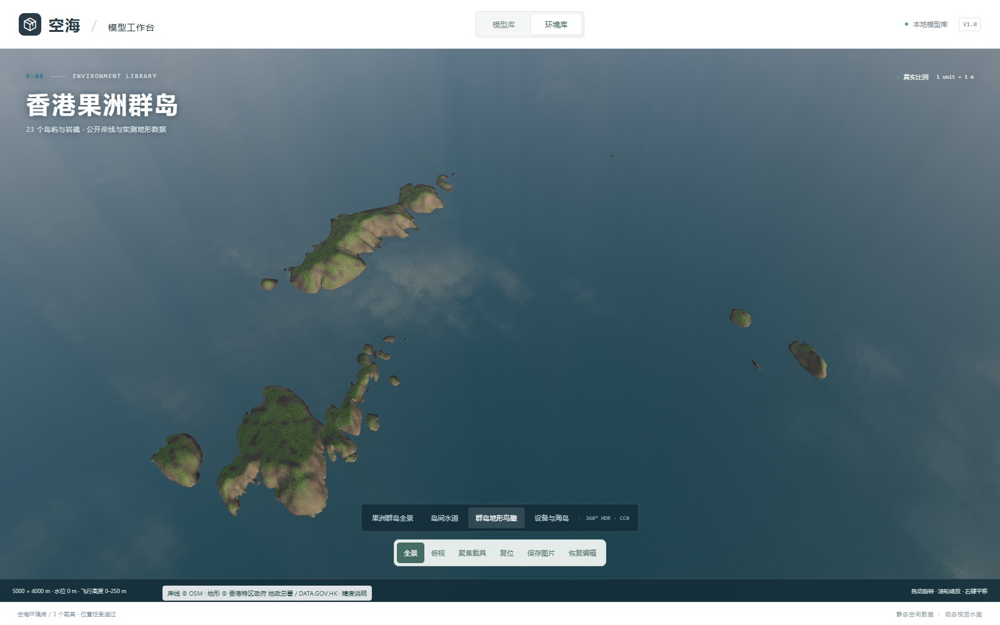
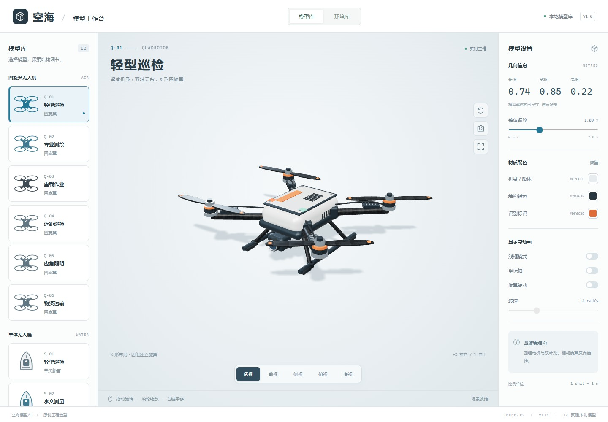
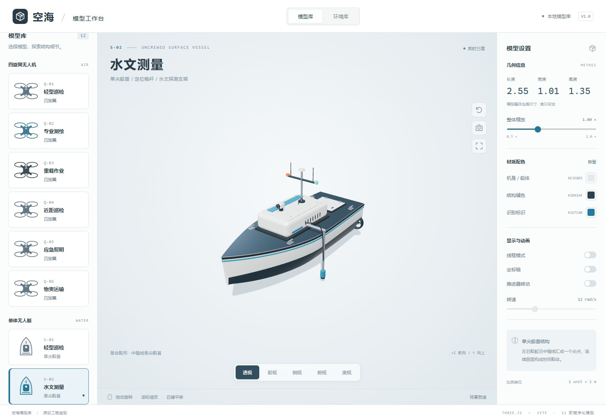
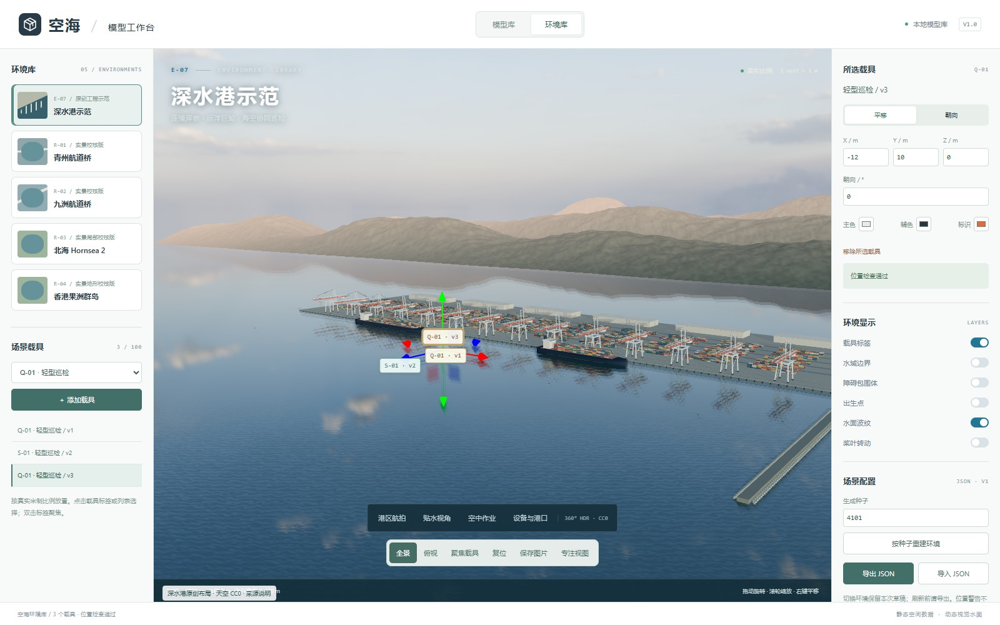
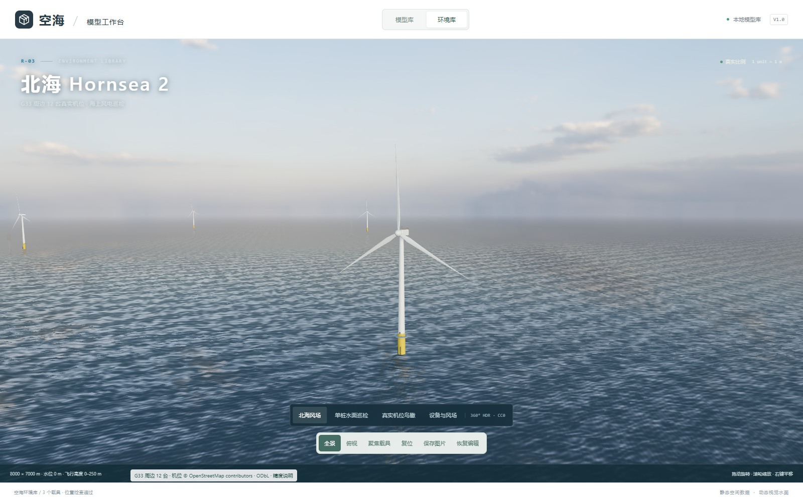
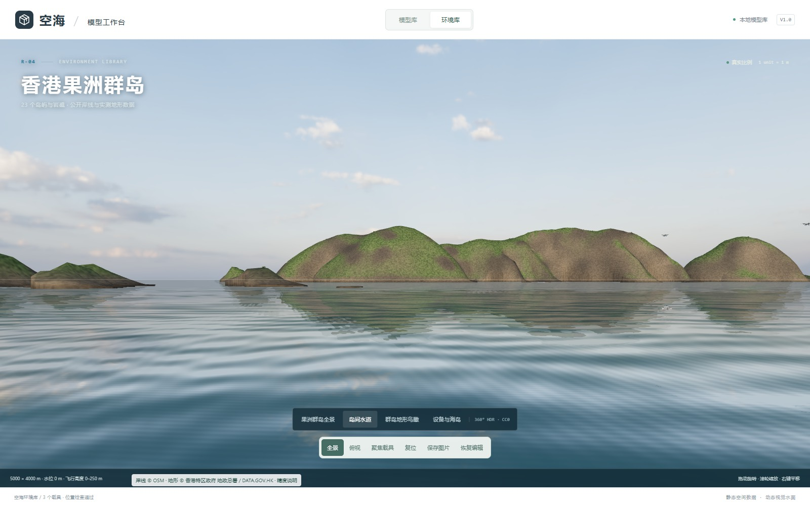

> 环境列表现有 **8 个场景**。2026-10-24 新增 **杭州西湖三岛水域、新加坡加冷盆地、鹿特丹瓦尔港**：采用真实 OSM 岸线与设施轮廓，每处预置 12 艘无人艇，附 8 条参考航线及空间数据。详见 [集群场景与精度说明](docs/usv-sites.md)。保留深水港、青州、九洲、Hornsea 2 和香港果洲群岛；六个通用环境继续保留 API 兼容。

# 空海 · 载具模型、水域环境与算法库

笔者用 GPT-6 Astra 建了一个素材库，现有 **18 款原创程序化三维模型、8 个可见水域场景、5 项无人艇算法实验**，基于 Three.js、Vite 和 TypeScript。模型与算法核心可以独立复用；工作台提供中文交互、标准视角、配色、缩放、线框、坐标轴、桨叶动画与 PNG 截图。

2026-10-24 扩充多光谱观测、空中中继无人机，以及多波束测深、通信中继、水面清理、水域巡逻无人艇。顶部新增「算法库」：A*、Dijkstra、领航跟随、一致性编队、分区往复覆盖，支持参数调整、暂停单步、轨迹回看、JSON / CSV 导出，以及将当前艇群带入三维环境。详见 [算法说明与复用接口](docs/algorithms.md) 和 [独立实验示例](examples/algorithms.ts)。

工作台现已统一界面与操作层级。模型库支持名称、编号和任务搜索；环境库将取景集中到视角菜单；算法库直接在三维水域中播放真实比例艇模型，提供航线全景、艇群近景、单艇聚焦与跟随。算法默认接入三自由度水动力学，也可显式选择运动学基线。第四个页签「动力学」提供 18 款载具的三维运动试验：无人艇的推力、附加质量、阻力、风流与转向，以及四旋翼六自由度刚体、四电机响应和姿态控制。可调参数、断开动力、回看完整姿态并导出记录。参数为未实测标定的工程估算，详见 [动力学方程、参数与边界](docs/dynamics.md)。完整按钮职责见 [界面操作说明](docs/interface.md)。

[GitHub 公开仓库](https://github.com/ZHT1235456/air-water-3d-asset-library) · [中文开发日志 PDF](docs/development-log/main.pdf) · [LaTeX 源码](docs/development-log/main.tex)

开发日志作者：**朱华天，GPT-6.1 Sol，GPT-6 Astra**；日期：**2026年10月22日**。日志以实际运行截图记录模型、实景数据、天空与海面融合、排查过程和验收结果。

## 运行截图



| 四旋翼无人机 | 单尖船首无人艇 |
| --- | --- |
|  |  |

| 深水港原创工程示范 | 北海 Hornsea 2 实景局部校核 |
| --- | --- |
|  |  |



截图来自本项目实际浏览器运行。深水港为原创工程示范；桥梁、风电场和群岛的数据精度、近似范围及第三方授权分别见环境说明与 `public/assets/*/sources.json`。天空使用 Poly Haven CC0 全景，未分发未获授权的实景参考照片。

## 项目范围

原始 API 提供六类通用水域环境：开阔湖面、曲折河道、港池码头、岛礁水域、跨河桥区、城市滨水。顶部切换“环境库”即可添加多个载具、编辑位置和朝向、检查碰撞并导入导出 JSON。环境接口与完整使用说明见 [环境库文档](docs/environments.md)，独立组合示例见 `examples/environment.ts`。

独立的 **E-07 深水港示范**可从环境列表选择：三维岸桥群、远洋集装箱船、堆场、远山与 CC0 摄影全景天空融合，支持港区航拍、贴水、空中作业、设备与港口四个镜头，以及专注视图。查看 [参考与授权记录](docs/marine-references.md)、[深水港组件说明](docs/marine.md) 和 `examples/marine.ts`。

八款无人机均为**四个旋翼、每个旋翼两片桨叶**。十款无人艇均为**单体船，左右船舷汇到中轴线上的唯一尖船首**。

## 启动

已在 Node.js 24 环境验证。首次安装依赖后，运行不需要外部模型、字体、贴图或 CDN 请求。

```sh
npm ci
npm run dev
```

访问终端显示的本地地址，默认 `http://127.0.0.1:5173/`。

```sh
npm test          # 无需浏览器的模型、拓扑及独立复用测试
npm run build    # TypeScript 检查与生产构建
npm run preview  # 查看 dist 中的生产构建
```

浏览器验收需先运行开发服务器，再执行 `npm run test:browser`；原六场景执行 `npm run test:environments`；深水港执行 `npm run test:marine`；群岛执行 `npm run test:ninepin`；新增三处集群场景执行 `npm run test:usv-sites`；模型扩充与算法执行 `npm run test:algorithms`；三维交互与按钮执行 `npm run test:ui`。脚本使用本机 Microsoft Edge 无头模式，新结果分别在 `artifacts/usv-sites/`、`artifacts/algorithms/` 和 `artifacts/ui/`。算法工作台与环境编辑器按需加载，共享本地地理数据块（gzip 约 858 kB），因此仍有 Vite 分块大小提示。实景环境另按需读取本地 4.43 MB HDR 文件，无需运行时联网。

## 十八款预设

所有数字均为**演示建模设定**，单位为米，不代表真实产品规格。长度沿 Z、宽度沿 X、高度沿 Y。工作台显示包括桨叶、天线和推进器在内的整体包围尺寸；尺寸在当前静止桨叶姿态下计算。

| 编号 | 构造函数 / variant | 名称 | 主体尺寸与结构 |
| --- | --- | --- | --- |
| Q-01 | `createQuadrotor / inspection` | 轻型巡检 | 中心机身长 0.30 × 宽 0.20 × 高 0.105；左右电机中心距 0.53，前后距 0.49；桨半径 0.175；短起落架与前置云台 |
| Q-02 | `createQuadrotor / survey` | 专业测绘 | 中心机身长 0.35 × 宽 0.27 × 高 0.12；左右中心距 0.80，前后距 0.72；桨半径 0.24；高起落架、测绘相机、扫描器及定位天线 |
| Q-03 | `createQuadrotor / heavy` | 重载作业 | 中心机身长 0.44 × 宽 0.36 × 高 0.16；左右中心距 1.10，前后距 0.96；桨半径 0.32；加粗机臂、双电池舱、载荷平台 |
| Q-04 | `createQuadrotor / protected` | 近距巡检 | 中心机身长 0.24 × 宽 0.19 × 高 0.10；左右中心距 0.48，前后距 0.46；桨半径 0.15；四个独立护圈、护圈支撑及前置云台 |
| Q-05 | `createQuadrotor / rescue` | 应急照明 | 中心机身长 0.36 × 宽 0.28 × 高 0.13；左右中心距 0.78，前后距 0.70；桨半径 0.23；双探照灯、定向扬声器与高起落架 |
| Q-06 | `createQuadrotor / cargo` | 物资运输 | 中心机身长 0.46 × 宽 0.38 × 高 0.17；左右中心距 1.18，前后距 1.06；桨半径 0.33；封闭货舱、绑带锁扣及双电池 |
| Q-07 | `createQuadrotor / multispectral` | 多光谱观测 | 中心机身长 0.38 × 宽 0.30 × 高 0.13；桨半径 0.245；四通道下视相机、顶置光照传感器、高起落架 |
| Q-08 | `createQuadrotor / relay` | 空中中继 | 中心机身长 0.40 × 宽 0.32 × 高 0.14；桨半径 0.26；通信设备舱、双面板天线、双鞭状天线 |
| S-01 | `createUSV / inspection` | 轻型巡检 | 船体长 1.80 × 设计宽 0.64；船底低于水线 0.22；巡检相机、封闭设备舱、单推进器 |
| S-02 | `createUSV / survey` | 水文测量 | 船体长 2.40 × 设计宽 0.92；船底低于水线 0.29；探测支架、探头、测量箱、定位桅杆、双推进器 |
| S-03 | `createUSV / utility` | 综合作业 | 船体长 3.20 × 设计宽 1.08；船底低于水线 0.34；抬高前甲板、作业平台、围栏、防撞条、双推进器 |
| S-04 | `createUSV / rescue` | 水上救援 | 船体长 2.20 × 设计宽 0.88；船底低于水线 0.26；双救生圈、船尾滚轮回收滑道、警示灯、双推进器 |
| S-05 | `createUSV / sampling` | 环境采样 | 船体长 2.80 × 设计宽 1.02；船底低于水线 0.31；六瓶采样盘、吊架、外置采样探头、双推进器 |
| S-06 | `createUSV / endurance` | 长航时观测 | 船体长 3.60 × 设计宽 1.12；船底低于水线 0.33；双太阳能板、气象观测桅杆、双推进器 |
| S-07 | `createUSV / multibeam` | 多波束测深 | 船体长 3.80 × 设计宽 1.20；船底低于水线 0.36；侧挂换能器阵列、船尾 A 架和绞车、双定位天线 |
| S-08 | `createUSV / relay` | 通信中继 | 船体长 3.00 × 设计宽 1.02；船底低于水线 0.30；球形天线罩、双面板天线、通信机柜 |
| S-09 | `createUSV / debris` | 水面清理 | 船体长 3.40 × 设计宽 1.22；船底低于水线 0.35；侧置回收输送带、网格收集筐、作业警示灯 |
| S-10 | `createUSV / patrol` | 水域巡逻 | 船体长 4.20 × 设计宽 1.18；船底低于水线 0.37；光电云台、观察支架、横向雷达、周向护舷 |

## 在自己的 Three.js 项目里复用

将整个 `src/models/` 目录复制到目标 TypeScript 项目，安装兼容的 `three` 与 `@types/three`，从 `models/index.ts` 导入。该目录只依赖 Three.js（含其官方 addons），不依赖工作台、Vite、DOM、Canvas 或渲染循环。完整版本以本仓库 `package-lock.json` 为准。

```ts
import { Scene } from 'three';
import { createQuadrotor, createUSV } from './models';

const scene = new Scene();
const drone = createQuadrotor({
  variant: 'survey',
  scale: 1,
  colors: { primary: '#e2e9ed', secondary: '#293b46', accent: '#267ca0' },
});
const boat = createUSV({ variant: 'inspection' });
drone.root.position.set(-1.5, 1.1, 0);
boat.root.position.set(1, 0, 0);
scene.add(drone.root, boat.root);

// 在使用方自己的渲染循环中调用：时间为秒，转速为弧度/秒。
function update(dt: number) {
  drone.update(dt, { rotorSpeed: 20 });
  boat.update(dt, { rotorSpeed: 5 });
}

// 访问具名部件；与 root.getObjectByName('gimbal') 是同一对象。
drone.parts.gimbal.rotation.y = Math.PI / 8;

// 不再使用时释放；不会影响另一个构造实例。
function dispose() {
  drone.dispose();
  boat.dispose();
}
```

可直接运行的无页面双模型示例在 `examples/independent.ts`，已纳入测试。展示时由使用方提供相机、光照及环境反射；工作台使用内置 RoomEnvironment，未下载 HDR 文件。

### 参数和返回值

```ts
createQuadrotor({ variant?: 'inspection' | 'survey' | 'heavy' | 'protected' | 'rescue' | 'cargo' | 'multispectral' | 'relay', scale?: number, colors?: ModelColors })
createUSV({ variant?: 'inspection' | 'survey' | 'utility' | 'rescue' | 'sampling' | 'endurance' | 'multibeam' | 'relay' | 'debris' | 'patrol', scale?: number, colors?: ModelColors })

interface ModelColors {
  primary?: THREE.ColorRepresentation;
  secondary?: THREE.ColorRepresentation;
  accent?: THREE.ColorRepresentation;
}

// 两个函数均返回：
{ root: THREE.Group, parts: Record<string, THREE.Object3D>, update, dispose }
```

- 默认款式为 `inspection`，默认缩放为 `1`；省略颜色时使用该款式默认配色。缩放必须是有限正数，未知款式会抛出 `RangeError`。
- Y 向上，+Z 为机头或船首方向。无人机原点在中心机身，无人艇原点在设计水线的船体纵向中点。
- `root` 可平移、旋转、缩放。颜色在创建时设置，页面改色通过替换实例并释放旧实例完成。
- `update(deltaSeconds, { rotorSpeed })` 不包含物理仿真；默认转速为 0，负转速反转。时间必须非负且有限，转速必须有限。相邻无人机旋翼反向旋转。
- `dispose()` 可重复调用，会将根节点从父节点移除，并对实例内共享的几何体、材质、纹理各释放一次。释放后 `update()` 不再执行。
- 构造函数之间不共享可释放资源。不要用 `root.clone()` 假定会得到独立资源的副本；需要独立生命周期时再次调用构造函数。

### 稳定部件名称

| 模型 | 部件名称 |
| --- | --- |
| 全部无人机 | `body`、`landing-gear`；四个方向 `front-left`、`front-right`、`rear-left`、`rear-right` 分别带 `arm-`、`motor-`、`rotor-` 前缀 |
| 轻型巡检 / 近距巡检 / 测绘 / 应急照明无人机 | `gimbal`、`camera` |
| 测绘无人机 | `scanner`、`gnss-antenna` |
| 重载 / 运输无人机 | `batteries`、`payload-platform`、`gnss-antenna` |
| 近距巡检无人机 | `guard-front-left`、`guard-front-right`、`guard-rear-left`、`guard-rear-right` |
| 应急照明无人机 | `searchlights`、`speaker`、`gnss-antenna` |
| 运输无人机 | `cargo-pod` |
| 多光谱无人机 | `multispectral-array`、`spectral-camera-1` 至 `spectral-camera-4`、`irradiance-sensor` |
| 空中中继无人机 | `radio-pod`、`relay-antennas` |
| 全部无人艇 | `hull`、`gunwale-left`、`gunwale-right`、`equipment-cabin`、`service-hatch`、`sensor-mast`、`gnss-antenna`、`camera` |
| 巡检无人艇 | `thruster-center`、`propeller-center` |
| 除轻型巡检外的无人艇 | `thruster-left`、`thruster-right`、`propeller-left`、`propeller-right` |
| 测量无人艇 | `water-probe` |
| 作业无人艇 | `work-platform`、`railing` |
| 救援无人艇 | `lifebuoys`、`recovery-ramp`、`rescue-beacon` |
| 采样无人艇 | `sample-carousel`、`sample-bottle-1` 至 `sample-bottle-6`、`sampling-davit`、`sampling-probe` |
| 长航时无人艇 | `solar-panels`、`solar-panel-left`、`solar-panel-right`、`weather-station` |
| 测深无人艇 | `multibeam-transducer`、`stern-a-frame` |
| 中继无人艇 | `communication-radome`、`communication-rack`、`directional-antennas` |
| 清理无人艇 | `collection-conveyor`、`collection-basket`、`work-beacon` |
| 巡逻无人艇 | `observation-tower`、`patrol-radar`、`patrol-camera`、`patrol-fenders` |

`left/right` 在模型局部坐标中分别对应 −X / +X，`front/rear` 分别对应 +Z / −Z。按名称访问部件时，先确认对应款式包含该部件。

## 工作台操作

- 左键拖动旋转，滚轮缩放，右键拖动平移；触屏单指旋转、双指缩放和平移。
- 目录上方按名称、编号或任务搜索 18 款模型；清空搜索恢复完整目录。窄屏首次进入时折叠目录，优先显示三维预览。
- 下方按钮切换透视、前视、侧视、俯视和底视。俯视中 +Z 朝上，底视隐藏地面以检查船底。
- 右侧改变主色、辅色、标识色及整体比例；每款的颜色和比例在当前页面会话中独立保留，刷新恢复默认。
- 线框、坐标轴、动画初始关闭。开启动画后可调整转速；缩放与切换模型会自动重新取景。
- 视口获得键盘焦点后，方向键旋转，`+` / `-` 缩放，`Home` 复位；所有控件均可通过键盘聚焦。
- 「保存图片」下载不含界面的当前模型 PNG；「全屏」展开模型视口，再次点击退出；窄屏按钮保留图标和辅助标签。
- 不支持 WebGL 2 或图形上下文中断时显示中文提示。

## 构造与验收说明

船体由 48 个纵向截面和唯一船首顶点生成，包含甲板、舷侧、底部及封闭船尾。逻辑网格经过闭合边、相反边方向、正体积、无退化面及唯一船首顶点检查；显示网格再按折角生成法线，使甲板与船舷交界清晰。完整船壳按材质合并为三个绘制批次。

材质包括涂装金属、金属紧固件、橡胶、镜头和程序生成的碳纤维纹理。当前适合近距离展示单个或少量模型，没有 LOD 或大规模编队优化。新增动力学模块包含三自由度水动力和六自由度飞行刚体模型；尚无实测标定、CFD、波浪耦合或真实飞控 SITL。算法库的物理模式通过推力制动，无法满足安全包络时终止实验；运动学基线仍可单独选择。不能把几何路线或实验收敛等同于实艇安全验证。

模型验收截图涵盖全部预设的透视与俯视、船体底视与侧视、桌面和 390 px 窄屏。浏览器验收还覆盖改色恢复、缩放、线框、动画、鼠标交互、截图下载及重复切换时 GPU 资源计数，详见 `artifacts/acceptance.json`。算法验收覆盖 5 项实验完成、8 个水域规划、暂停与单步、轨迹导出、历史时刻三维快照、无效参数与窄屏布局，详见 `artifacts/algorithms/acceptance.json`。探照灯、扬声器、采样装置、太阳能板及新增任务设备表现其外观结构，不模拟照明、声音、采样、发电、测深、通信或垃圾回收过程。
